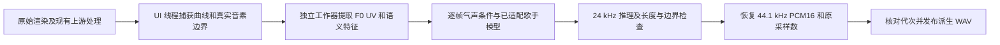

# 神经气声后端接入方案

状态：不采用已测试的整段神经重合成路线。2026 年 10 月 20 日用户试听确认声码器有电声感，零气声技巧重建也显著改变音色，停止沿该路线调参或声库微调。下文是历史接口探索，不作为实施计划；BAIB/CSSC 仅完成数据接口准备，未运行其训练权重，不能将其视为已验证替代方案。

## 已核对的源码版本

| 系统 | 提交 | 接口结论 |
| --- | --- | --- |
| [CSSC](https://github.com/HuZhetao/cssc/tree/b7da6eec3599995aa1b85ec4f41ba13288b1c430) | `b7da6eec3599995aa1b85ec4f41ba13288b1c430` | `SynthesizerTrn.infer` 直接接收逐帧技巧矩阵，适合曲线实验 |
| [VibE-SVC2](https://github.com/castlechoi/VibE-SVC2/tree/a21a7b40dc378e59d33bde8e350f07c9392e7bcf) | `a21a7b40dc378e59d33bde8e350f07c9392e7bcf` | 技巧和歌手通过嵌入表进入条件分支，默认技巧是整段 ID |

源码克隆在本机独立研究目录，未移植进补丁。随后已在独立 Python 环境跑通 VibE-SVC2、HuBERT-soft 与 BigVGAN，音频、性能和原声库保留评估见 [初音与天依的神经气声实测](ace-air-neural-comparison.md)。未启动 VOCALOID Editor。

## CSSC 的具体输入

调用形态为 `model.infer(wsp, f0, uv, note, ph, tec, g=singer, noice_scale=..., predict_f0=False)`。批次大小以 1 为例：

| 字段 | 形状 | 来源与要求 |
| --- | --- | --- |
| `wsp` | `[1, 1024, T]` | 与训练权重匹配的 Whisper medium 表征，按配套配置汇聚 |
| `f0` | `[1, T]` | 原始渲染音频的实际基频，保留颤音与滑音；不能用 MIDI 恒定频率替代 |
| `uv` | `[1, T]` | 与实际音频对应的清浊音标记 |
| `note` | `[1, T]` | 已对齐的 MIDI 音符，空白帧为零 |
| `ph` | `[1, T]` | 配套 263 项词表中的音素 ID |
| `tec` | `[1, 6, T]` | 顺序为 mix、falsetto、breathy、pharyngeal、glissando、vibrato |
| `singer` | `[1, 1]` | 模型训练过的歌手 ID；不能临时把任意声库 ID 转成整数来代替 |

`tec` 进入六通道卷积层，数据加载器允许 `[0,1]` 浮点数，因此连续曲线在张量和文件格式层面可接。连续数值能否带来自然且单调的强度变化，仍取决于训练分布和试听结果。[模型接口](https://github.com/HuZhetao/cssc/blob/b7da6eec3599995aa1b85ec4f41ba13288b1c430/models.py)、[数据加载器](https://github.com/HuZhetao/cssc/blob/b7da6eec3599995aa1b85ec4f41ba13288b1c430/data_utils.py)

CLI 必须使用 `-tech original` 保留输入 JSON 中的技巧曲线。使用 `-tech breathy` 会将技巧矩阵清零后把整个气声通道设为 1，丢失曲线。`noice_scale` 控制潜变量采样噪声，不是气声强度；`predict_f0` 首轮保持关闭，避免另行预测歌曲音高。[命令行实现](https://github.com/HuZhetao/cssc/blob/b7da6eec3599995aa1b85ec4f41ba13288b1c430/inference_main.py)

## 离线数据适配器

`voicebank/tools/ace_neural_probe/prepare_cssc.py` 读取标准库可解析的单声道 PCM16 输入，通过 FFmpeg 转为 24 kHz，并写出：

- `sample.wav`：单声道 24 kHz PCM16，原文件保留。
- `sample.json`：音符、明确映射过的模型音素和逐帧气声条件。
- `preparation.json`：源文件、配置和词表的 SHA256，以及帧数、尾部长度和待准备的模型输入。

第一轮只支持正向 Air，取面板值 `v` 对应的 `(v - 50) / 50`。负向 Air 明确拒绝，不把“减少原有气声”冒充为普通发声条件。其他五个技巧通道置零作为参考重建条件；这不保证模型重建原声，需单独验收。空白、休止和独立气口不额外增加气声条件。

请求示例中的时间已经处于源 WAV 的秒坐标，音素为人工确认的模型词表标签：

```json
{
  "schema_version": 1,
  "source_wave": "input.wav",
  "air_units": "ace-signed",
  "air": [
    {"seconds": 0.0, "value": 0.0},
    {"seconds": 0.256, "value": 1.0},
    {"seconds": 0.512, "value": 0.0}
  ],
  "notes": [{"start": 0.128, "end": 0.896, "midi": 60}],
  "phonemes": [{"start": 0.128, "end": 0.896, "model_token": "a"}]
}
```

运行方式：

```powershell
python voicebank/tools/ace_neural_probe/prepare_cssc.py --request <request.json> --cssc-root <CSSC源码目录> --output <新的输出目录>
python voicebank/tools/ace_neural_probe/test_prepare_cssc.py --cssc-root <CSSC源码目录> -v
```

适配器执行五项契约检查：分数气声值与上游区间取整规则一致、返回中性、暂停区间不增加技巧值、负向值和未知音素被拒绝，以及源文件和已有输出不被覆盖。它没有导入 PyTorch 或运行上游数据加载器；区间放置检查依据已核对的加载器规则。当前 5 项通过。

模型还需要配套权重、歌手映射、`sample.wav.f0.npy` 和 `sample.wav.wsp.pt`。这些输入齐备后才可以用上游 CLI 做推理：

```powershell
# 从 CSSC 根目录运行，配置和歌手 ID 必须与训练权重配套
python inference_main.py -m <G权重> -c <配套配置> --input-dir <准备目录> -n sample.wav --speaker-id <已训练歌手ID> -tech original -od <新的结果目录>
```

## 需要处理的时间和音素问题

默认帧移为 `256 / 24000` 秒，即约 10.667 ms。上游频谱长度为 `floor(音频采样数 / 256)`，输出可能少于输入尾部。1.03 秒测试音频的 24720 个采样只覆盖 96 帧、24576 个输出采样，少 144 个采样，即 6 ms。适配器明确报告该长度；宿主不能直接替换成更短的 WAV。后续需保留原始长度，以原声补回模型未覆盖的尾部，并验收接缝。

音素必须使用真实音素起止时间，不能平均分配音符长度。正式快照应在 Dispatcher 捕获 `GetPhonemePositions()` 的边界，再按现有规则转换为与源 WAV 一致的秒坐标，包含 Part 起点、tempo 变化和 PresendTime；后台不读取 VSM 对象。

模型音素标签与 VOCALOID 标签不能按字符串自动混用。例如模型词表的 `N` 对应其自身的英语标签，不足以证明它与日语 VOCALOID 的同名音素语义一致。需要按声库语言建立并检查映射；找不到映射时停止该片段实验，不静默使用 `<UNK>`。适配器要求调用方提供明确的 `model_token`。

## 宿主接入位置



可接在 `AceAcousticHost.Process(Request)` 目前调用 `AceAcousticWave.Create` 的位置。保留现有去抖、串行工作限额、generation 和缓存发布逻辑。需要增加后端选择及不可变音符、音素快照，并把后端版本、模型/配置/词表哈希加入缓存签名。力度增益可在模型输出后处理；张力与假声先不混入此试验，避免把旧 DSP 与新模型的效果混为一谈。

正式工作器应复用已加载模型，避免每次划线都启动 Python、重新加载语义模型和转换器。由补丁启动的工作器使用隐藏窗口、结构化请求和明确的取消/超时；过期输出不得发布。预览失败回退原声，导出继续采用现有“派生结果未准备好则不静默导出”的规则。

四条曲线全为中性时沿用原文件，避免不必要的神经重建。局部中性区也必须保留原声；不能仅因为目标技巧为零就宣称模型输出与原声相同。生成片段边界需额外验证相位和接缝，不能用整段原声/生成声的音量混合代替气声条件。

## VibE-SVC2 的可用资源与限制

Hugging Face 模型 API 返回 HTTP 401，但作者提供的备用 Google Drive 共享目录可读取。已取得并运行 `pretrain/vibe_timbre/model_200000.pt`，文件为 660740594 字节。配套配置为 1922 字节，SHA256 为 `89f195f1dd3c518d23b21220304f8de739ea908ac1db9623d9389309b3a0843f`。实验严格匹配全部模型参数，不使用随机权重回退。[作者的权重入口说明](https://github.com/castlechoi/VibE-SVC2/blob/a21a7b40dc378e59d33bde8e350f07c9392e7bcf/README.md)

配套配置确认使用 HuBERT-soft、20 个歌手和四种技巧。接入所需的不仅是主权重，还包括语义编码器、F0 提取器和 BigVGAN 声码器。其扩散转换器权重不能加载进 CSSC 的 VITS 转换器。

`get_unit_f0_shc` 默认按目标歌手统计值与源 F0 均值的比例缩放整段 F0。要保留歌曲音高，必须绕过该缩放，并直接向底层模型传入原 F0。对现成 `straight` 与 `breathy` 嵌入进行逐帧插值在结构上可探索，但属于新增适配，尚无本项目的连续控制听感证据。[推理实现](https://github.com/castlechoi/VibE-SVC2/blob/a21a7b40dc378e59d33bde8e350f07c9392e7bcf/inference/infer_vibesvcII.py)

## 接入前剩余的实质工作

CSSC 当前仓库要求另行准备转换权重，未找到可直接用于本机声库的配套检查点。VibE-SVC2 的现成歌手嵌入也不包含本机 VOCALOID 声库。两条路线都必须解决原声库适配；仅选择一个现成歌手 ID 会转换音色。

原先提出的声库专用嵌入或小规模适配不再继续。用户试听已否决当前声码器与技巧重建链路，不以重新选择歌手 ID、调整扩散深度或微调作为继续该路线的理由。

接入探索完成了源码接口核对、离线数据适配器和 5 项契约检查，随后也完成了真实权重在初音和天依上的离线推理。运行成功、听感验收不通过；音频、测量与用户结论见 [实测记录](ace-air-neural-comparison.md)。没有部署。
