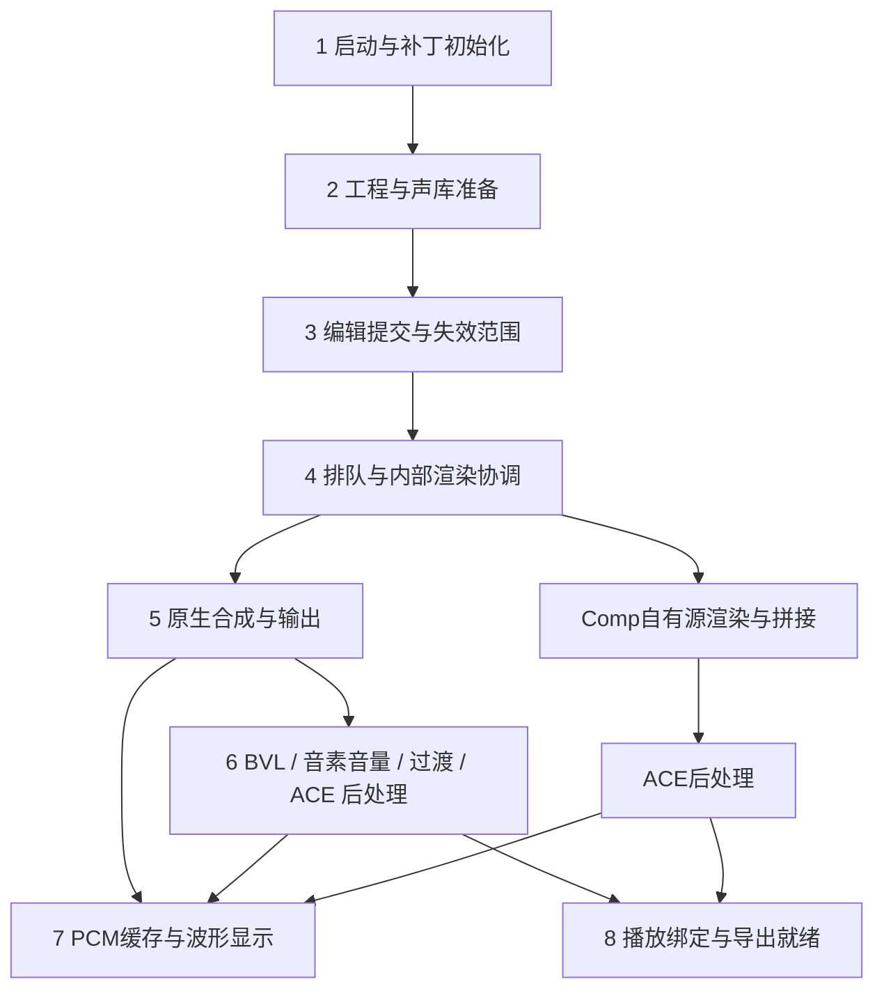

# 启动、首次出声与重复渲染：分层研究

日期：2026-10-23。目标是缩短从启动/载入工程到得到可用音频，以及后续编辑到新结果可用的等待时间。

本轮完成源码与既有证据审查，没有修改产品代码或用户设置，没有部署、启动或关闭 Editor，没有新增端到端性能实测。当前工作区已有大量未提交改动，以下结论针对本次读取的工作区源码，不代表某个已发布提交。

## 1. 先分开三个目标

| 目标 | 起点 → 终点 | 需要单独记录的中间点 |
| --- | --- | --- |
| 启动可用 | 进程启动 → 主界面可接受编辑 | 补丁加载、原生管理器初始化、工程载入、布局完成 |
| 首次出声 | 本轮渲染输入确定 → 首份可播放的新音频 | 请求、真正开始、首块 PCM、最终原生 WAV、派生 WAV 绑定 |
| 编辑后完整可用 | 最后一次实际编辑提交 → 同一版本的最终音源绑定 | 失效、停止旧任务、排队、合成、后处理、发布；波形显示另记 |

首块音频、完整音频、波形显示与可导出不是同一个终点。缩短首块等待不一定提高整段吞吐；只推迟工作也不一定减少最终等待。若必须按播放键才听到，还要另测播放请求到设备输出的延迟。

端到端时间按关键路径计算。并发与嵌套阶段不能简单相加，线程等待时间也不能当 CPU 时间。

## 2. 八层执行路径

图中 Comp 是替代路径：其自有源处理已经承担部分上游功能，不能把普通 Part 的全部后处理再重复套到 Comp 输出上。实际功能关闭或中性时应短路。

| 层 | 已核对的入口 | 提速方向 | 当前证据边界 |
| --- | --- | --- | --- |
| 1 启动 | `PatcherInit`、`StartupProfiler`、`DsePreloader`；原生 `App.InitializeModule` | 找同步长阶段；延后与首次编辑无关的资源准备；避免重复初始化 | 有计时工具，没有本轮启动日志 |
| 2 工程/声库 | `Sequence.InitializeForLoad`、`DeferAudioBufferLoadPatch`、`FirstTrackProfiler` | 避免全工程同步扫描；复用元数据；有界预热当前所需声库 | 伴奏 PCM 后台载入等措施已存在；仍需测首个声库上下文 |
| 3 提交/失效 | `Transaction.EndProc`、`SampledTimingHost`、`RegisterShiftService` | 只失效实际依赖的 Part/音符上下文；只改后处理的操作复用原生音频 | 有明确的历史跨 Part 放大路径，已有部分修复 |
| 4 调度 | `NativeRenderSession`、`EvecRenderCoordinator`、分段拼音、`VoiceCompHost` | 最新请求优先、复用内部源、减少无效开始/停止和排队 | 已有多种门闩与缓存；尚无本轮逐请求关联计数 |
| 5 合成 | VSM 异步渲染、DSE；AI 需单列另一后端 | 区分准备、素材读取、逐帧合成、写出；验证缓存命中与并发瓶颈 | 当前 Ghidra DSE 与安装文件不匹配，不能照搬地址 |
| 6 后处理 | `BreathVolumeService`、`PhonemeVolumeHost`、`TransitionSmoothingHost`、`AceAcousticHost` | 减少串联去抖、过期处理、整文件搬运和重复发布 | 多层独立定时、文件生成和发布已由源码确认，端到端代价待测 |
| 7 显示 | `RenderedWaveCachePatch`、`WaveformSnapshot`、`RendererPreviewThrottlePatch` | 缓存包络、合并最终刷新、限制可视范围的布局绘制 | 已有异步加载、加载票据、30 FPS 预览节流等措施 |
| 8 绑定/导出 | 各 Host 的 `RefreshPlacement`、`PhonemeVolumeExport.Prepare` | 一次发布最新完整结果；导出等待同一版本的完成任务 | 原生完成、后处理完成和最终绑定需要分别观测 |

## 3. 最先值得验证的五个方向

### A. 热路径是否被工作集修剪抵消

`Settings.TrimWorkingSet` 源码默认开启。`WorkingSetTrimPatch` 在工程载入成功后、`RenderCompleteTrimPatch` 在 `AudioPlayer.OnRendererCompleted` 后调用 `ScheduleTrim`。共用的 DispatcherTimer 每次重置，最后一次调度约一秒后执行 `EmptyWorkingSet`；计时到点时没有再次检查是否又开始渲染。

Windows 文档说明该 API 会尽可能把页面移出指定进程的工作集，见 [Microsoft：EmptyWorkingSet](https://learn.microsoft.com/en-us/windows/win32/api/psapi/nf-psapi-emptyworkingset)。因此这里存在一个待测假设：刚渲染完就修剪，可能让下一轮编辑/后处理重新付出页面调入成本。工作集数字变小本身不证明计算或内存分配减少。

第一项实验只比较开启/关闭修剪，保持工程和其它设置相同；覆盖完成后立即再编辑、等待超过一秒再编辑、多 Part 连续渲染。记录热渲染端到端时间、缺页、磁盘读取、CPU、工作集与 Private Bytes。后两项分别观察，不用工作集下降替代内存泄漏判断。

若验证存在回退，再考虑把自动修剪改为最小化/明确内存压力下执行，或提供偏向速度的策略。本轮没有更改开关。

后续已完成 [工作集修剪隔离 A/B](working-set-render-ab-2026-10-23.md)：随机三组确认中，下一轮原生渲染配对中位额外耗时约 10.14 ms（2.63%），不是 Editor 整体提速比例；默认值和用户设置未改动。

依据：`Utils/WorkingSetTrimmer.cs`、`Patch/Patches/WorkingSetTrimPatch.cs`、`Config/Settings.cs`。

### B. 减少一次编辑引起的重复工作

现有时值 `Flush` 会停止 sequence 渲染、对目标上下文失效、发布控制数据，再恢复渲染。`Publish` 也有停止渲染路径。REG 的 `ForceNativeRender` 为保证缓存正确，目前会触碰并恢复 Part 内全部音符的 Velocity。EVEC、分段拼音、Comp 还会创建内部渲染任务。

这些调用是候选观测点，不能仅凭出现多个 `StartAsyncRendering` 就认定合成了多遍：请求可能无工作、命中缓存或属于不同的必要内部源。需要关联实际 started/completed/canceled 和 PCM 产出。

优化按两步推进：

1. 为同一次提交记录受影响 Part、请求来源、render epoch、输入版本、实际开始/取消、内部源数量与缓存命中；先找没有输入变化却重复产生 PCM 的路径。
2. 在已证实的依赖范围内收窄失效，保留音素前后文、连音、tempo、控制器与声库依赖。REG 全音符失效曾修复后段音符不更新，不能直接退回“只碰第一个音符”。

`PhonemeVolumeHost.SourceChanged` 会对本 sequence 已跟踪的 Part 重新请求；`AceAcousticHost.SourceChanged` 也扫描符合条件的 Part。可以继续研究把“有变化”通知变为带 Part/变化类别的通知，并在清掉缓存、取消任务之前判断实际输入是否变化。这里仍须保留撤销、tempo 和全局变化的保守回退。

已有修复与历史测量见 [十分钟采样报告](performance-sampling-2026-10-21.md)。其中 UI 线程约 37.70 秒采样落在临时元数据工程关闭调用链，包含于其它统计行，不能叠加；工程复用已完成，后续应复测，不重复把这项列成新优化。

依据：`ConsonantTiming/SampledTimingHost.cs`、`ConsonantTiming/Backend/SampledTimingVsmBinding.cs`、`RegisterShift/RegisterShiftService.cs`、各 Host 的 `SourceChanged`。

### C. 后处理只等待一次稳定期，按依赖生成最终结果

普通 Part 的音频依赖顺序是 BVL → 音素音量 → 过渡平滑 → ACE。源码中的编辑去抖入口分别存在 250 / 100 / 100 / 120 ms 等待，且上游完成或路径变化能继续触发下游请求。它们并非每次必然全部串行，不能直接声称固定多等 570 ms。

四层各有文件处理路径：BVL 读写完整文件；音素音量复制文件后修改窗口；过渡平滑读取文件并写出结果；ACE 读取 WAV 后处理并写出新文件。独立层发布会重新绑定音源、使显示缓存失效。现有 Dispatcher 合并可以合并同一轮刷新，不能保证跨异步完成时刻只刷新一次。

第一阶段可先保持现有 DSP 与文件格式，增加按 Part/版本协调的依赖任务：

- 用户编辑的一次去抖只负责合并编辑；确定版本后，下游等待上游完成任务，不再把每次上游完成当作新一轮用户编辑。
- 若输入版本改变，取消可取消的旧工作；不可取消的工作结束后丢弃结果，始终只保留最新候选请求。
- 后处理参数改变时复用有效原生 WAV；只运行发生变化的阶段及其下游。
- 记录并限制中间发布次数，最终音源和波形刷新按完整版本合并。需要保留原声/渐进预览时，明确标识预览版本。
- 导出等待同一依赖任务，不能为了速度跳过未完成处理。

第二阶段再研究内存/分块流水线，减少文件搬运。直接把所有 DSP 融合为浮点处理会改变原有阶段之间的量化、饱和及舍入，因此必须先定义音频一致性标准；中性路径仍要求精确透传，处理顺序保持。

Comp 源缓存已剥离 Offset/Trim 等仅影响拼接的字段，并设有 32 项缓存上限；应先测命中率，不能把“新增供体缓存”当作尚未存在的机制。Comp 完成后有自己的音源刷新与 ACE 触发，应纳入同一最终版本判定。

依据：四个 Host/Service、`Rendering/WaveProcessingReadScope.cs`、`VoiceComp/VoiceCompHost.cs`、`Patch/Patches/PhonemeVolumeExportPatches.cs`。

后续进展：[普通 Part 后处理复用](post-processing-reuse-2026-10-23.md) 已减少未变化文件重算；[就绪调度](post-processing-ready-2026-10-23.md) 已移除已就绪路径重新绑定的重复稳定期，保留编辑截止时间和上游待完成保护。完整依赖任务图、中间/最终音源发布及显示刷新合并尚未完成。

### D. 有界声库预热与缓存分层

`DsePreloader` 目前用 `NativeLibrary.Load` 加载 DSE_DFT / DSE 模块，没有建立可用于歌曲的声库合成上下文。因此 DLL 已预加载不能证明首次渲染已经热身。

可比较“不预热”“只预加载模块”“目标声库准备/极短隔离渲染”三组。先测创建管理器、声库首次准备、首块与最终 WAV 的时间，再决定是否需要预热。只预热当前所需的声库，取消过期任务，避免与前台渲染竞争；不能把等待移到启动阶段后仅报告第一次编辑更快。

至少区分四类缓存：

| 缓存 | 已有机制 | 优化时需观察 |
| --- | --- | --- |
| VSM 原生渲染缓存 | 原生 `SequenceManager.CacheCapacity`；参考代码默认 1 GiB，可选至 8 GiB | 命中/淘汰及实际峰值内存；不能据容量推断覆盖哪些内部对象 |
| 时值元数据准备 | `LocalConsonantTimingBackend` 已复用最多五个空闲映射工程 | 准备/归还/最终销毁成本，不能误当音频结果缓存 |
| 显示 PCM/缩略图 | `RenderedWaveCachePatch` 有按 Part 的 LRU、两个加载名额；`FreeAudioPcmCache` 下容量为 4，否则为 1 | 以 Part 数限制可能不适应长短差异；可研究按字节预算和活跃 Part 保护 |
| 派生音频/Comp 源 | 各处理层缓存、Comp 原始源缓存 | 版本正确性、缓存命中率、重复文件字节数、峰值空间 |

`AudioPcmReleasePatch` 清理的是 `AugmentedAudioBuffer` 的 `WaveData`，缩略图有独立复用路径，不等于清掉 VSM 合成缓存。显示缓存容量还与这个开关耦合，A/B 时必须拆清影响，不能笼统归因于“清缓存”。

### E. 最后再深入原生吞吐与并发

当前只读 Ghidra 查询成功，活动目标为 x64 `DSE.dll`，映像基址 `0x180000000`，SHA-256 为 `7a4965bd377dbc2b08710e807ae1345b67d9fff6579ca0c01a769f744366f5b5`。已经成功查询函数/导出并反编译实际入口，但该目标不等于本机当前安装版本。

本机安装的 DSE 版本为 6.13.3.1，SHA-256 为 `844452f19271b66634a625f37068933baddd607c3670278c58580528a3ce9dfd`。参考源码的文件头实际标注 VOCALOID6 6.13.1.1，不能仅沿用仓库说明中的旧版本标签。

下一轮需要先在版本匹配的分析目标上定位 VSM 调度与 DSE 准备/合成边界，再做运行时 CPU、文件读取、锁等待与调用次数对照。旧目标只用于提示研究方向，不给当前 DLL 提供可部署地址或补丁依据。本轮没有切换 Ghidra Program、导入文件或修改项目。

传统 DSE 与 AI 合成分别测量。没有证据支持此时直接增加线程、去掉全局门闩或改用 GPU。`NativeRenderSession.Gate`、Comp 的 `SourceWorker`、ACE 的单工作名额分别保护不同资源；解除限制前需要确认独立上下文、峰值内存和前台调度。

分块可以单独研究首块延迟：参考代码默认块长 4000 ms、Part 时长阈值 600000 ms。配置值不证明某个短 Part 实际走了分块路径。调整后要同时测首块和整段耗时、回调/UI 开销以及接缝，不把减少块长当作必然提升吞吐。

## 4. 测量设计

### 关联字段与事件边界

建议沿用现有低频边界诊断，增加单调时钟、进程/会话、Part、用户提交版本、内部源类别、render epoch、阶段、开始/结束、取消/失效原因、缓存命中、队列等待与处理时长。原生回调若没有请求 ID，通过经过核对的 Part/epoch 映射关联；无法唯一归属时标记未知，不猜配对。

事件至少覆盖：进程启动、补丁开始/结束、模块准备、工程加载结束、用户提交、实际原生开始、首块 PCM、原生完成、各后处理就绪、最终音源绑定，以及首次正确版本的波形实际绘制。后两项应分开测。

`StartAsyncRendering` 是异步请求，调用自身耗时不能代表合成耗时。现有 `RuntimeObservationPatch` 的 `render_idle` 通知位于原生完成入口，单独使用它不能证明全部派生处理与最终绑定已经完成；还要核对各 Host 的版本/完成状态。

现有启动与首轨 profiler 可作入口，覆盖范围由实际安装时刻决定，不能看到补丁加载前的全部过程。它们有同步日志写盘，测量时应评估观测开销。新增计数优先内存累计、边界输出，不在每帧/每样本/MouseMove 挂重日志。

### 固定输入矩阵

| 场景 | 控制变量 | 要回答的问题 |
| --- | --- | --- |
| 新进程首次用目标声库 | 相同工程、声库、音符和设置 | 一次性初始化占多少？ |
| 同进程另一声库首次使用 | 已热模块，未使用过该声库 | 声库准备与模块加载能否分离？ |
| 热上下文重复输入 | 相同输入、已完成缓存 | 实际能命中哪些结果？ |
| 单音符/参数编辑 | 分别改音高、歌词、REG、音素时值、BVL、音素音量、ACE | 哪些必须合成，哪些只需后处理？ |
| 两个 Part，只改一个 | 保持另一 Part 不动 | 非目标 Part 是否实际重算？ |
| EVEC/扩展拼音/Comp | 分别开启，再做必要组合 | 内部源数、队列与缓存代价是多少？ |
| 长短 Part、不同音符密度 | 固定声库与音频时长，分别改变密度 | 成本随音频长度还是音符/源数量增长？ |
| 连续快速操作后停止 | 相同最终输入，改变中间编辑频率 | 旧任务是否积压？最终结果是否及时且正确？ |

将“新进程”“声库冷启动”“操作系统文件缓存冷”分别标记。重复启动并不保证 OS 文件缓存冷，本轮不清空系统缓存。实验顺序交错，记录版本、输入摘要、设置、硬件与后台负载。

热路径可先做 5 次排障样本，正式对比至少 30 次再看 P50/P95/最大值；新进程测试单独列每次结果，不用少数样本制造稳定的 P95。原生合成 RTF 用合成墙钟时间除以有效输出音频时长，后处理和端到端等待另列。全工程实际开始/取消数、过期任务处理时间、磁盘读取/写出字节数、托管分配与峰值内存一起报告。

## 5. 实施顺序与验收

1. 建立版本匹配的分层基线，补齐最终结果就绪边界；先做工作集修剪 A/B。
2. 按提交统计渲染来源与 Part，处理已证实的额外失效/重复启动，复测既有临时工程复用。
3. 协调普通 Part 后处理依赖：先减少多次等待和发布，保留 DSP 与文件语义。
4. 在数据支持下调整缓存预算、当前声库预热与内部源复用。
5. 若剩余时间确实集中于原生合成，再做匹配版本的内核分析、分块与有界并发实验。

每一步都同时检查同一最终输入的音频与工程状态。调度/缓存优化优先要求结果逐样本或文件摘要一致；若涉及 DSP 数学改变，另定误差和听感标准，不能混为一次纯性能优化。保留中性透传、音素真实边界、取消/撤销重做、保存重开、多 Part、Comp 所有权与导出等待。波形保留、渐进遮罩和缩放也继续作为验收约束。

已有离线基准见 [后处理与界面性能报告](performance-optimization-2026-10-21.md)。例如 12 秒合成元音的气声处理曾从约 508 ms 降到 202 ms；它仅覆盖离线 DSP，不能换算成 Editor 启动或整段渲染的提速比例。

本轮工具边界：VOCALOID MCP 实例列表为空，配置目录没有现成的 `startup-profile.log` 或 `first-track-profile.log`。因此尚不能给八层填上可信的当前耗时占比，也没有新的宿主提速百分比。
